# Persistent deep-over-shallow VWC at S3 and S4: diagnostic audit

**Status:** Unresolved research diagnostic; not a causal finding

## Introduction

This audit addresses a persistent and unexplained pattern in the soil-moisture record: volumetric water content (VWC) at 18 inches is almost always higher than the corresponding 6- and 12-inch measurements at S3—most conspicuously at S3 Top—and also at S4 Top. The deep-over-shallow difference at S3 Top has generally become larger over time.

The pattern matters because it can influence estimates of profile water storage, irrigation response, and biochar-versus-control differences. The available data do not provide a satisfactory explanation. Actual subsurface water distribution, soil-profile differences, sensor calibration, installation contact, and other site effects remain plausible and may act together.

The purpose of this document is therefore to define the mystery, document its history, examine whether irrigation timing or other recorded events clarify it, and identify evidence that could distinguish among explanations. It does not claim that the pattern is caused by biochar, a ditch, a pipe leak, or any other single mechanism.

## What the evidence currently supports

The 18-inch sensor exceeds both shallower sensors at the Top positions of S3 and S4 from the first available 2023 growing-season observations. The ordering therefore did not first appear in 2025 or 2026. It becomes stronger at S3T and appears at additional positions over time, so a later external source could amplify the pattern, but a recently started ditch or recent pipe break cannot by itself explain its original presence.

- S3 Top median deep-over-shallow difference (VWC percentage points): 2023: 8.07, 2024: 7.96, 2025: 12.77, 2026: 16.80.
- S4 Top median deep-over-shallow difference (VWC percentage points): 2023: 4.45, 2024: 3.73, 2025: 4.79, 2026: 7.03.

Because each depth uses a different CS650 sensor, absolute depth ordering can also reflect sensor calibration, installation contact, and soil texture. These plots are evidence for where and when to investigate; they do not by themselves prove a ditch or pipe leak.

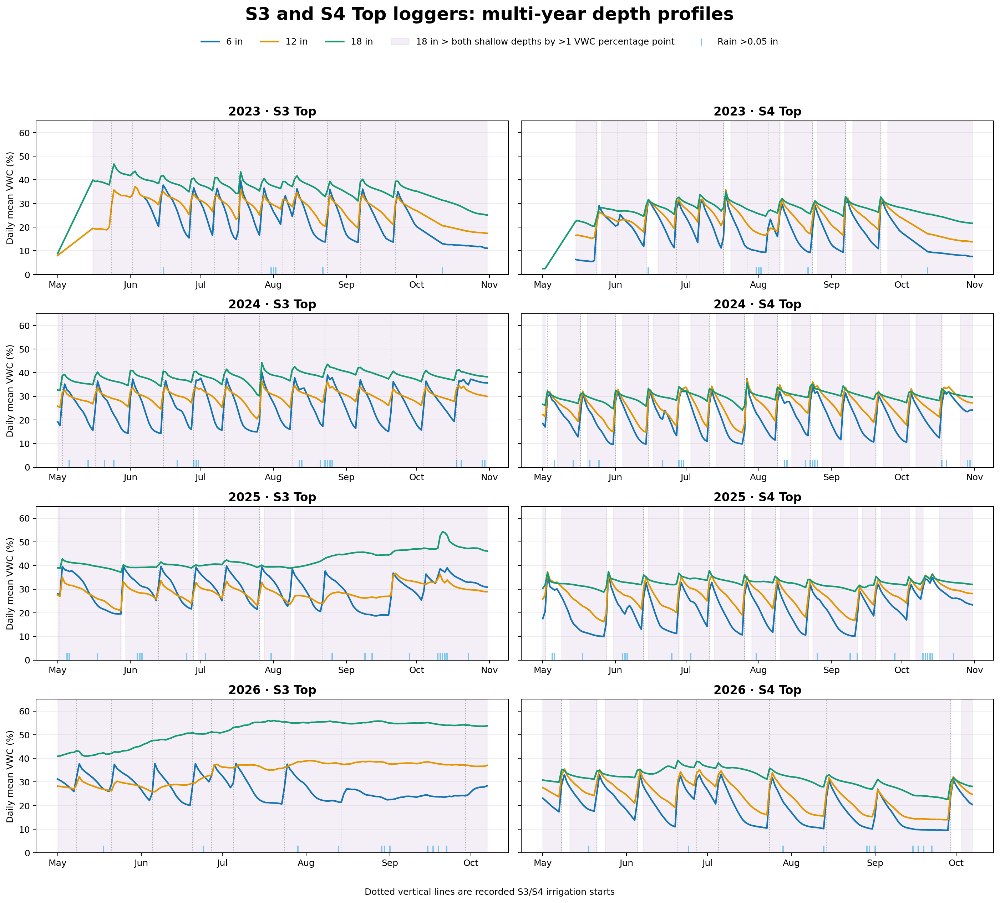

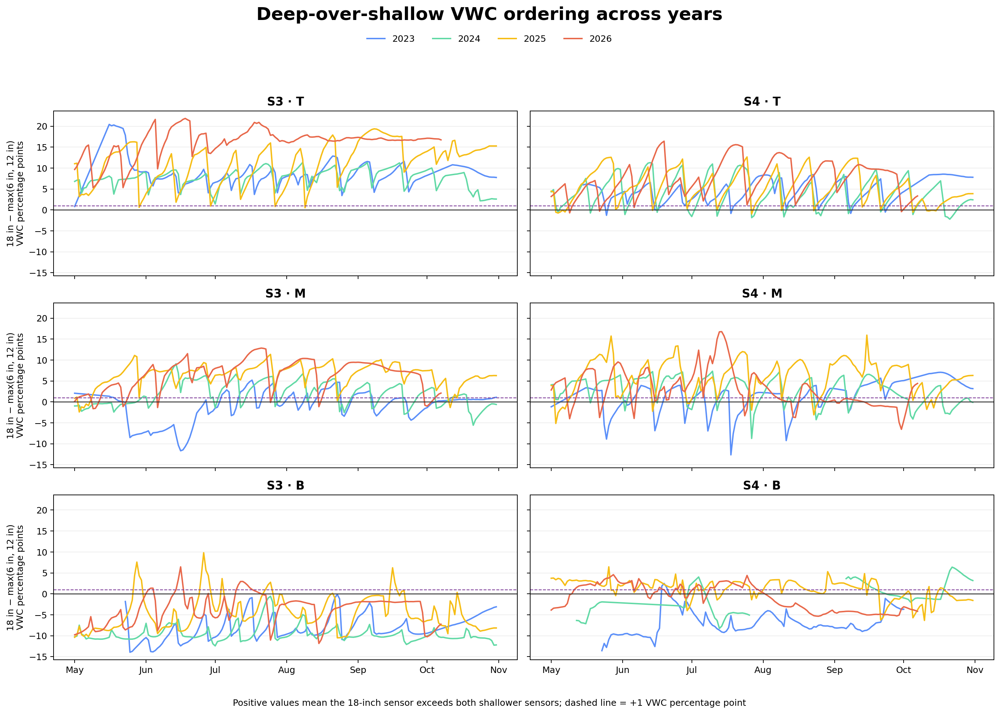

## Possible explanations and current evidence

The audit retains several non-exclusive explanations:

- **Actual soil-profile or site differences.** Texture, layering, compaction, and local water-holding properties could produce wetter conditions at 18 inches.
- **Lateral or subsurface water input.** Irrigation redistribution, unrecorded water entering from the east or north, or a buried-pipe leak could add deep water, but no independent source record currently confirms any of these mechanisms.
- **Sensor or installation effects.** Calibration offsets, soil contact, disturbed soil around installation, or sensor-specific behavior could affect absolute depth comparisons.
- **Event definition and water accounting.** Shared irrigation boundaries, assumed equal strip allocation, and incomplete knowledge of runoff, drainage, and advance timing can affect event-scale interpretations without explaining the persistent baseline ordering by themselves.

None of the available checks distinguishes decisively among these explanations. The persistent pattern is therefore retained as an unresolved research question.

## Definitions used in this audit

- **Shared canonical irrigation boundary:** one recorded start and end time applies to both S3 and S4 because they are irrigated as one metered pair. It is the workbook/photo reference time, not a claim that water reached every logger simultaneously.
- **Sensor arrival:** the first sustained VWC increase after the recorded boundary that meets the standard response threshold of +0.25 VWC percentage point. Arrival delay is sensor arrival minus the shared boundary.
- **Deep-over-shallow difference:** 18-inch VWC minus the larger of the simultaneous 6- and 12-inch VWC values. A positive value describes sensor ordering; it does not by itself demonstrate upward or lateral water movement.
- **Deep-rise candidate:** an exploratory daily observation outside recorded irrigation and material rain when 18-inch mean VWC rose by at least 1 percentage point and at least 0.75 percentage point more than either shallower depth. It is a screening flag, not a confirmed leak.
- **Directional episode:** deep-rise candidates no more than two days apart, grouped as one episode, where the screen fires in S4 first and subsequently in S3. The term describes the observed east-to-west sequence only.
- **Eligible event:** an event with the required complete sensor coverage and established quality-control checks for the reported calculation. Failed events remain in the detailed table as an audit trail but are omitted from eligible-event summaries.

## Supporting investigation 1: 2026 irrigation timing

There are 9 S3/S4 irrigation events in 2026. 9 have a reviewed start photograph, 9 have a reviewed end photograph, and 7 start photographs agree exactly with the workbook boundary. 2 need boundary review, 1 has field-wide pre-start drift, 0 has a directional pre-start flag, and 6 are usable with no clock flag. No event supports an additional S3M clock correction.

### Photo source and coverage

The audit does **not** treat either review workbook as its final authority. The source chain is `meter_photo_review.xlsx` plus `meter_photo_unresolved_review.xlsx` → `photo_inventory_unique.csv` → `meter_photo_workbook_qc.csv` → this timing audit. The canonical inventory contains 24 dated 2026 photographs through September 29, 2026. For the nine S3/S4 events, the derived QC file contains 9 start photographs and 9 end photographs. Thus the earlier count of 7 meant exact start-time agreement, not that only that many photographs existed. A content-alignment check found that every 2026 photo referenced by the derived QC file exists in the finalized canonical inventory with the same manual counter reading. The event-level QC is therefore current with the reviewed photo content. The August 14 event now has reviewed start and end photographs.

S3 and S4 use one shared canonical irrigation boundary for each S3/S4 event. The June 27 photo is about 54 minutes later than the workbook start and lacks a confirming counter, so that event should not anchor absolute timing.

The latest date also has 3 reviewed photos (IMG_9123.HEIC, IMG_9124.HEIC, IMG_9139.HEIC) dated September 29, 2026. They are retained as unmatched evidence because the irrigation event table does not yet provide a confirmed strip assignment for them. They are not assigned to S3/S4 or used in event calculations.

| Event | Start photo? | Start photo | Photo − workbook (min) | Timing decision |
|---|---|---|---:|---|
| 2026-04-21 | yes | IMG_7795.HEIC | 0.9 | review field wide pre start drift |
| 2026-05-08 | yes | IMG_7932.HEIC | 0.0 | usable no clock flag |
| 2026-05-21 | yes | IMG_8060.HEIC | 0.1 | usable no clock flag |
| 2026-06-05 | yes | IMG_8192.HEIC | 0.0 | usable no clock flag |
| 2026-06-20 | yes | IMG_8344.HEIC | 0.2 | usable no clock flag |
| 2026-06-27 | yes | IMG_8416.HEIC | 54.4 | review irrigation boundary |
| 2026-07-05 | yes | IMG_8467.HEIC | 0.6 | usable no clock flag |
| 2026-07-24 | yes | IMG_8600.jpg | 0.3 | usable no clock flag |
| 2026-08-14 | yes | IMG_8789.jpg | — | review irrigation boundary |

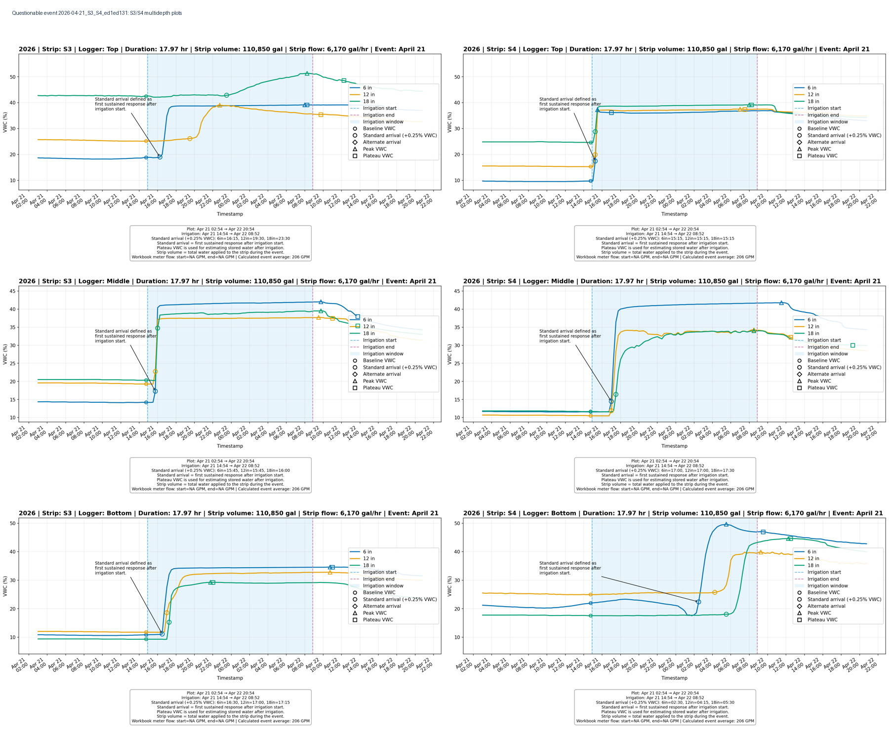

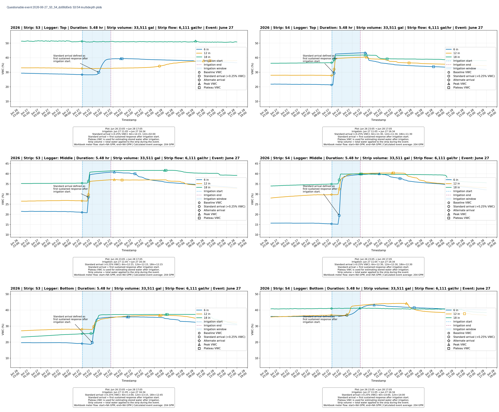

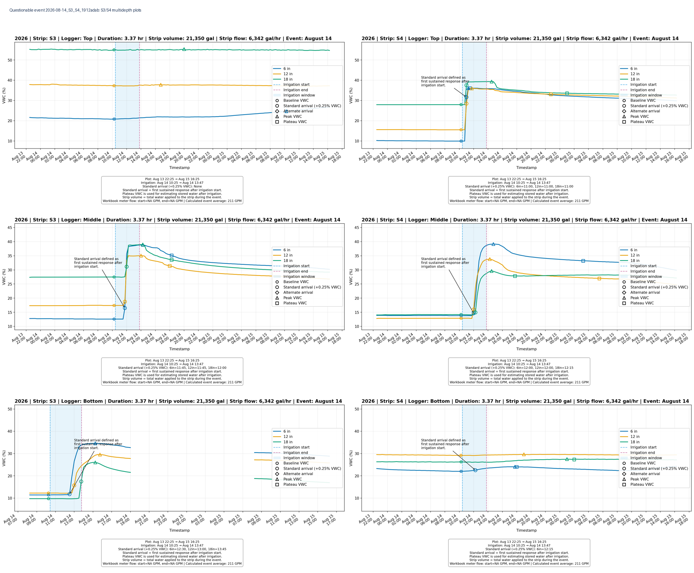

### Interpretation of the supplied 15-minute plots

**June 27:** the workbook boundary is 11:05, while the start photograph is 54.4 minutes later and the flowmeter was not turning. All plotted responses occur after the workbook boundary. S4 Top responds quickly at all three depths; S3 Top responds later at 6 inches, then 12 inches, with little 18-inch response in this window. This supports a real irrigation response and different advance between the strips, but it does not resolve which of the two candidate start times is exact. The event remains a boundary-review event, not a clock error.

**April 21:** the workbook boundary (14:54) and photograph (14:54:55) agree. At S3 Top, the main response is after that boundary and progresses from 6 to 12 to 18 inches. The automated pre-start screen nevertheless found a smaller six-hour rise at S3 Top (6-inch VWC, +0.586 percentage point) and S4 Bottom (6-inch VWC, +1.692 percentage points). Crucially, S1 Bottom (+0.625) and S2 Bottom (+0.623) also rose before the same start. The corrected interpretation is therefore field-wide pre-start drift or an event-boundary/field-condition issue, not evidence of a particular external source.

## Supporting investigation 2: unexplained daily deep rises

The exploratory screen found 31 daily deep-rise candidates across all S3/S4 positions and years after excluding recorded irrigation on the current/previous day and precipitation above 0.05 inch. A candidate requires the 18-inch daily mean to rise by at least 1 VWC percentage point and by at least 0.75 percentage point more than the larger shallow-depth change. No ditch-use, north-boundary inflow, or pipe-leak record is currently available. These candidates identify dates on which such external records or field observations would be useful.

The candidates form 12 episodes. 5 begin at S4 and reach S3 later; 0 have a comparable screened response at S1 or S2. The recurring S4-first, S3-later episodes in 2025 and June 2026 establish a directional sensor-response pattern only. They are compatible with several mechanisms, including redistribution of recorded irrigation, unrecorded entry from the east or north, a subsurface pipe leak, or sensor/site effects. With no independent record of those sources, the water source remains unknown.

| Episode | Start–end | First sites | Later sites | S4→S3 lag | West response? |
|---|---|---|---|---:|---|
| 2025-02 | May 26–May 27 | S4B,S4M | S3B,S4B,S4M | 1 day | no |
| 2025-04 | Jul 28–Jul 29 | S4B,S4M | S3B,S4B,S4M | 1 day | no |
| 2025-05 | Aug 29–Aug 30 | S4B,S4M | S3B,S4B,S4M | 1 day | no |
| 2025-06 | Sep 14–Sep 16 | S4B,S4M | S3B,S3M,S4B,S4M | 1 day | no |
| 2026-01 | Jun 11–Jun 15 | S4M | S3B,S4M | 1 day | no |

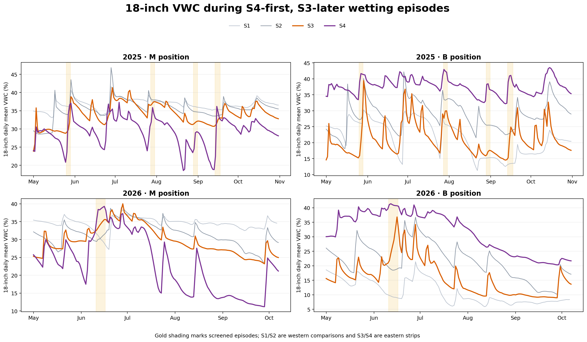

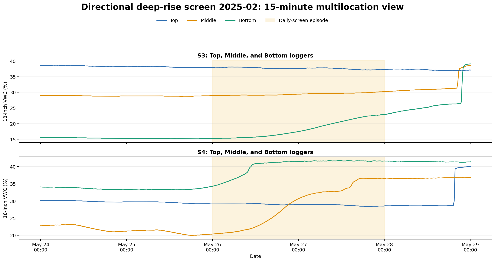

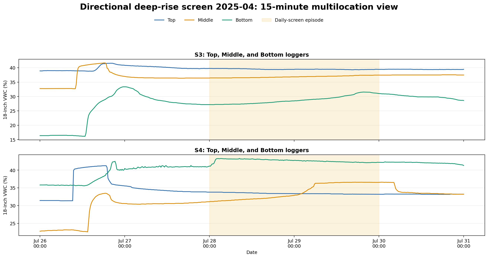

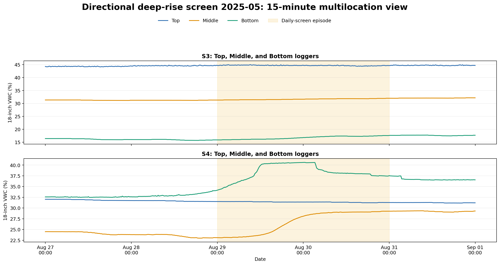

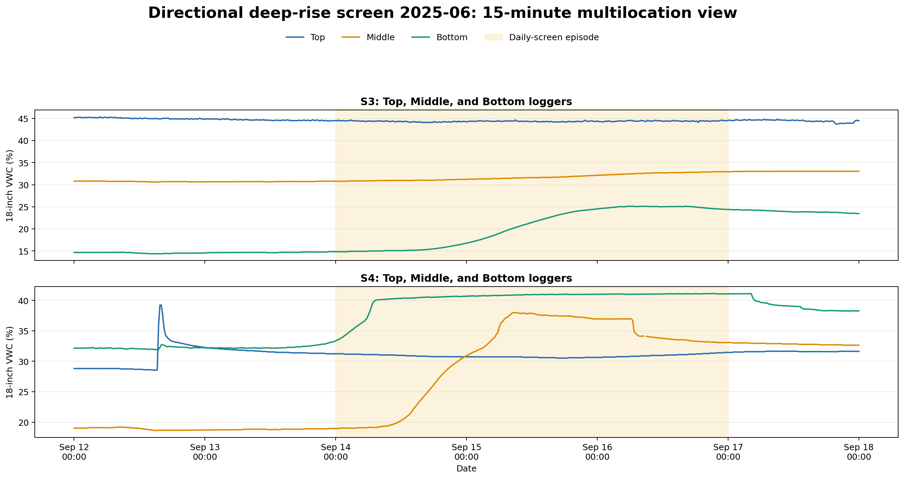

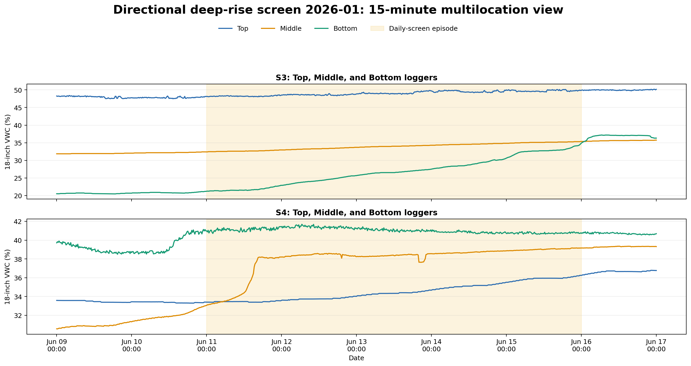

## Supporting investigation 3: event water balance

### Why calculate it?

The purpose is to test whether the observed increase in monitored soil-water storage can plausibly account for the water assigned to each strip, and whether the paired biochar and control strips differ consistently. It is also a way to identify events that deserve closer review. It is **not** yet a direct estimate of runoff, deep drainage, or water savings.

### Calculation sequence

1. **Assigned applied water:** the shared meter total for a strip pair is divided equally between its two strips. This is an assumption because strip-specific inflow was not measured.
2. **Modeled 0–18-inch storage change:** pre-event VWC is compared with the accepted post-event response at 6, 12, and 18 inches for the Top, Middle, and Bottom field zones; VWC changes are converted to gallons using the modeled soil and zone volumes and summed.
3. **Signed residual:** assigned applied water minus modeled storage change. A negative value means modeled storage exceeded assigned water and signals measurement, timing, allocation, or spatial-representation error rather than creation of water.
4. **Nonnegative unretained proxy:** max(signed residual, 0). This legacy descriptive field prevents negative 'unretained water,' but clipping makes it unsuitable as the sole paired treatment comparison.
5. **Paired difference:** the biochar-strip value minus the control-strip value is calculated within the same irrigation event. Pairing controls for the shared event but not for persistent soil, topographic, lateral-water, or unequal-delivery differences between strips.

Because the calculation assigns exactly the same applied-water amount, *A*, to the two strips, the paired signed-residual difference is not an independent result. Algebraically, `(A − storage_biochar) − (A − storage_control) = −(storage_biochar − storage_control)`. That is why the two former columns had equal magnitudes and opposite signs. The redundant signed-residual-difference column has been removed from this summary; the detailed CSV retains the strip-level residuals for auditing.

The event table retains both eligible and failed rows so exclusions can be audited. Neither residual separates runoff from deep drainage, lateral redistribution, continued infiltration, unequal gate delivery, or model error.

| Year | Pair | Eligible events | Median applied/strip (gal) | Biochar storage (gal) | Control storage (gal) | Biochar − control storage (gal) | Stored-fraction difference |
|---:|---|---:|---:|---:|---:|---:|---:|
| 2024 | S1/S2 | 3 | 53,000 | 34,204 | 38,589 | -4,088 | -0.080 |
| 2024 | S3/S4 | 4 | 47,375 | 22,570 | 22,211 | 1,655 | 0.040 |
| 2025 | S1/S2 | 6 | 75,175 | 31,049 | 36,269 | -8,760 | -0.120 |
| 2025 | S3/S4 | 6 | 66,825 | 22,474 | 20,010 | 2,497 | 0.050 |
| 2026 | S1/S2 | 5 | 34,125 | 20,084 | 29,611 | -7,329 | -0.220 |
| 2026 | S3/S4 | 1 | 90,350 | 22,578 | 22,683 | -105 | 0.000 |

No 2023 pair met the complete matched-event criteria used for this table.

For 2026, fully eligible matched-event counts are:

- S1_S2: 5 events.
- S3_S4: 1 events.

The small matched-event counts—especially for 2026 S3/S4—mean the present residual differences are diagnostics, not defensible runoff or deep-drainage treatment effects.

## What remains unknown and how to investigate it

Historical ditch-use dates and pipe-pressure, shutoff, repair, or leak-observation records are not available. The ditch and buried-pipe explanations therefore cannot be tested retrospectively against operational records. They remain unverified hypotheses, not pending record requests.

1. Resolve the June 27 start boundary using the original start/end photographs, file metadata, field notes, and any valve-opening record; retain the 11:05 and 11:59 alternatives until that review is complete.
2. Review April 21 field operations across both irrigation pairs. The pre-start drift is visible in all four strips, so test common causes before interpreting it as external water.
3. Inspect 15-minute S4 Middle/Bottom and S3 Middle/Bottom traces for each directional episode. Daily means identify candidates but cannot establish hour-scale direction.
4. Check sensor-specific offsets and installation context, especially the persistent S3T and S4T 18-inch-over-shallow ordering that is already present in 2023.
5. Verify strip-specific delivery in future irrigation events. Temporary inflow measurements at both gates would test the equal-allocation assumption used in the water balance.
6. In future field work, measure or bound tailwater at the south end and add deeper-than-18-inch observations if runoff and deep drainage are to be separated rather than combined in a residual.
7. Recalculate treatment effects after excluding unresolved boundary and directional-pattern episodes, then compare the result with the full-data estimate as a sensitivity analysis.

## Generated files and reproducibility

Regenerate this report, its tables, and its figures from the current reviewed inputs with:

```bash
MPLBACKEND=Agg python -m biochar_app.scripts.research.analyze_s3_s4_multiyear_water
```

- `multiyear_top_depth_profiles.png`: four years of S3/S4 Top depth traces.
- `multiyear_deep_dominance.png`: the depth-order metric for all positions and years.
- `lateral_episode_comparison.png`: 2025–2026 east-versus-west 18-inch traces with S4-first episodes highlighted.
- `questionable_event_*.png`: contact sheets made from the existing S3/S4 event-multidepth plots.
- `directional_episode_*_multilocation.png`: 15-minute Top/Middle/Bottom views for each S4-first, S3-later episode.
- `deep_dominance_summary.csv`: annual persistence and magnitude statistics.
- `unexplained_deep_rise_candidates.csv`: dry/non-irrigation deep-rise screen.
- `unexplained_deep_wetting_episodes.csv`: grouped candidate episodes and direction.
- `s3_s4_2026_event_timing_audit.csv`: event timing and photo-anchor decisions.
- `paired_event_water_balance.csv`: complete S1/S2 and S3/S4 paired event table.
- `paired_event_water_balance_summary.csv`: eligible annual paired summaries.
